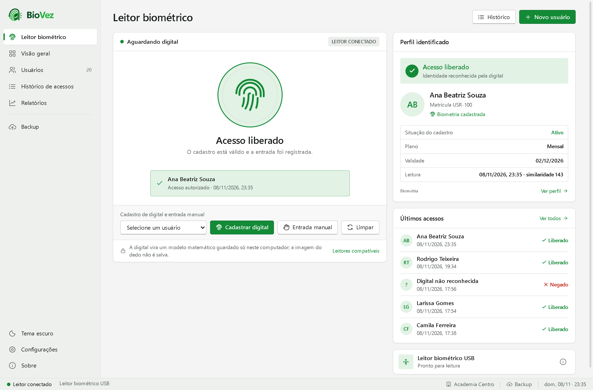
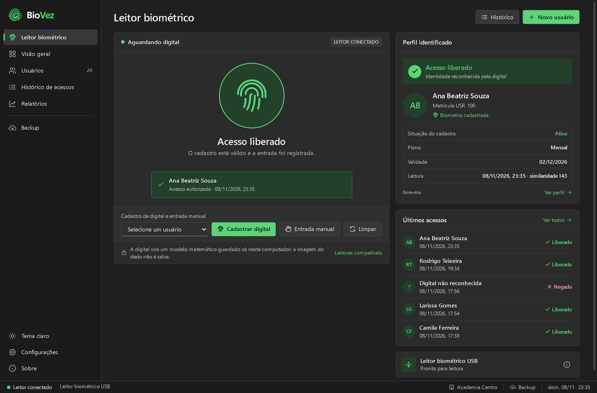
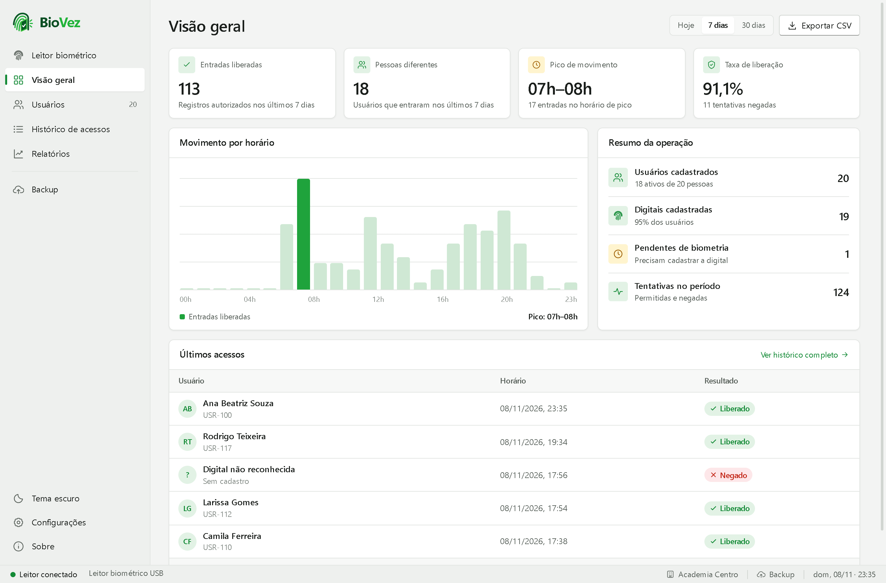
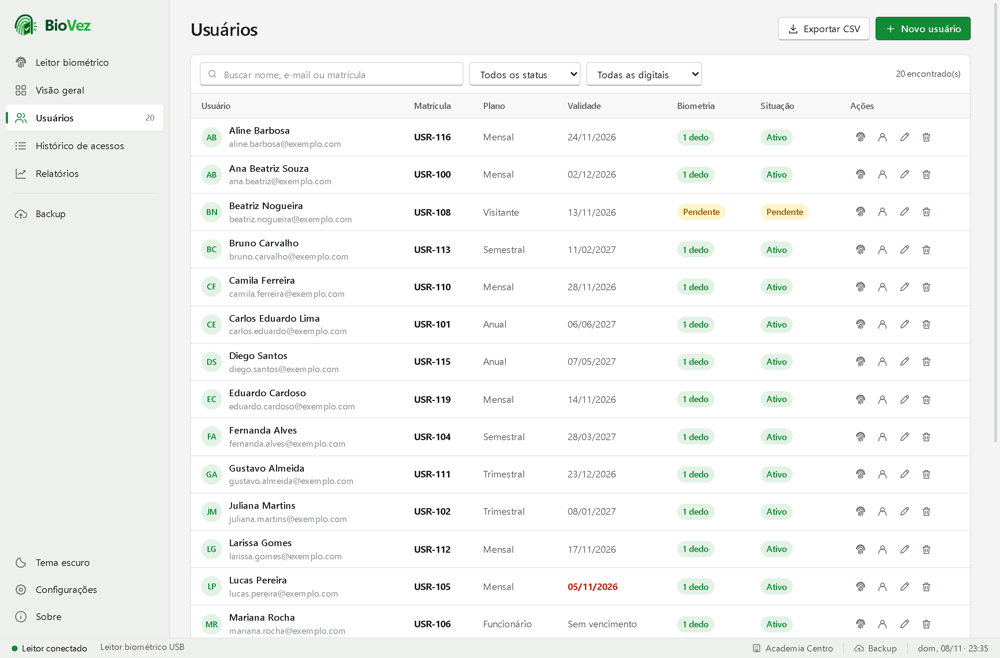
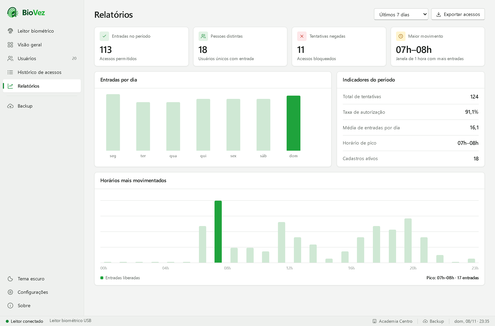

# BioVez

**BioVez** é um sistema de controle de acesso biométrico para Windows 10 e 11: identifica a pessoa pela impressão digital, aplica as regras de entrada e registra cada acesso. Tudo fica no seu computador.

**[⬇ Baixar o BioVez](https://srtob.github.io/BioVez-download/)** · [todas as versões](https://github.com/SrTob/BioVez-download/releases)

## Telas

| Leitor biométrico (tema escuro) | Visão geral |
|---|---|
|  |  |
| **Usuários** | **Relatórios** |
|  |  |

As telas mostram dados de demonstração com pessoas fictícias.

## Requisitos

- Windows 10 ou 11, 64 bits
- Leitor de digital USB com driver do Windows (WBF)
- Permissão de administrador para instalar

Este repositório contém apenas a página de download, as imagens e os instaladores. O código-fonte do BioVez é privado.

Copyright © 2026 Miguel Tobias. Todos os direitos reservados. O uso do BioVez é regido pela [licença](LICENSE). Componentes de terceiros: [THIRD-PARTY-NOTICES.md](THIRD-PARTY-NOTICES.md).

Criador: [Miguel Tobias](https://github.com/SrTob) · [LinkedIn](https://www.linkedin.com/in/miguel-tobias-482a06401/) · [Instagram](https://www.instagram.com/kk.tob/)
